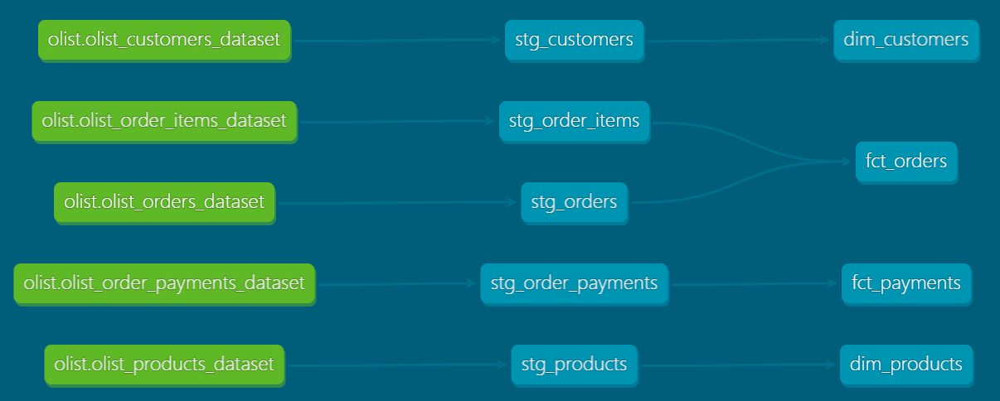

#  Olist Analytics Pipeline (dbt + Databricks)

Este proyecto implementa un pipeline de transformación de datos utilizando **dbt (data build tool)** sobre el dataset público de e-commerce de **Olist (Brasil)**. Los datos se procesan en Databricks (Unity Catalog) y se modelan siguiendo las mejores prácticas de la industria.

##  Arquitectura y Modelado

El proyecto sigue el estándar de dbt para organizar las transformaciones en capas:

1. **Staging (`stg_`):** Limpieza, casteo de tipos de datos (`TRY_CAST`) y estandarización de nombres de columnas.
2. **Marts (`dim_` y `fct_`):** Modelado dimensional (Esquema Estrella) listo para ser consumido por herramientas de BI.

### Modelo Estrella (Star Schema)
*   **Dimensiones:**
    *   `dim_customers`: Información demográfica y ubicación de los clientes.
    *   `dim_products`: Catálogo de productos y categorías.
*   **Tablas de Hechos:**
    *   `fct_orders`: Resumen financiero por pedido (ingresos por ítems + envío).
    *   `fct_payments`: Detalle transaccional de los pagos realizados.

##  Calidad de Datos (Data Quality)

El proyecto incluye **tests automáticos de dbt** para garantizar la integridad del pipeline antes de que los datos lleguen a producción:
*   `unique` y `not_null` en todas las claves primarias (evita duplicados y valores vacíos).
*   Uso de `ROW_NUMBER()` para deduplicar pedidos en la capa de Staging.
*   Uso de `COALESCE` para manejar pedidos sin ítems y evitar nulos en las sumatorias.

##  Tecnologías Utilizadas

*   **Transformación:** dbt Cloud (Core)
*   **Data Warehouse:** Databricks (SQL Warehouse, Unity Catalog)
*   **Lenguaje:** SQL analítico (Spark SQL)
*   **Control de versiones:** Git / GitHub

##  Linaje de Datos (DAG)

